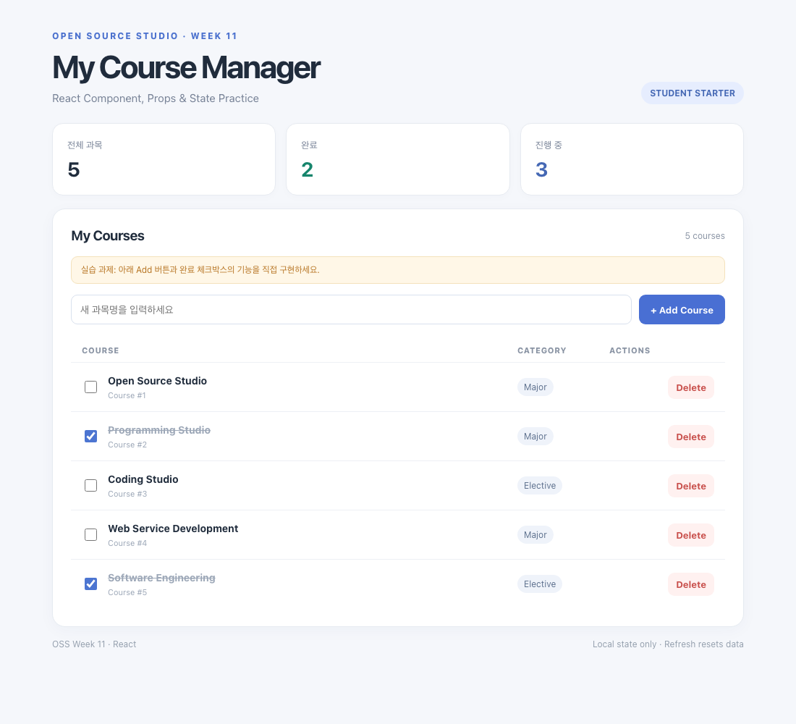

# OSS Week 11 — React Course Manager (Student Starter)

React + Vite 기반 학생 배포용 Sample Project입니다. **조회와 삭제는 완성**, 등록 및 완료 변경은 학생이 직접 구현하도록 `TODO`로 남겨두었습니다.

## 실행 방법

Node.js 20.19+ 또는 22.12+ 권장.

```bash
npm install
npm run dev
```

브라우저에 표시되는 Local URL에 접속하세요. 빌드 테스트: `npm run build`.

## 소스 구조

- `src/App.jsx`: 페이지 전체 레이아웃
- `src/components/CourseList.jsx`: State 및 목록, 삭제 로직, **TODO 1/2**
- `src/components/CourseItem.jsx`: Props로 데이터를 받고 이벤트 콜백 호출
- `src/data/courses.js`: 초기 과목 데이터
- `src/App.css`: 전체 디자인

## 수행 내용

1. 코드를 실행하고 목록 조회·삭제를 확인합니다.
2. 초기 과목 5개 이상, 제목, CSS 3곳 이상 변경합니다.
3. `CourseList.jsx`의 **TODO 1**: 과목 등록 (빈 값 입력 방지, 고유 id 지정, State 업데이트).
4. `CourseList.jsx`의 **TODO 2**: 완료 체크박스 클릭 시 `completed` 상태 변경.
5. 선택: 검색/필터, 이름 수정 기능 추가.
6. GitHub에 Commit/Push 후 Vercel에 배포합니다.
7. README에 프로젝트 소개, 주요 코드 분석 2개, 변경 내용, Weekly Review, GitHub URL, Vercel URL을 정리합니다.

## 확인할 질문

- `CourseList`와 `CourseItem`의 역할은?
CourseList는 전체 과목 목록과 상태를 관리한다. 
과목 추가,삭제,완료 상태 변경,검색을 담당한다. 상단 통계 영역과 검색창,과목 목록 전체 틀을 렌더링한다.
CourseItem는 부모로부터 전달받은 과목 정보를 화면에 보여주고, 체크박스 클릭이나 삭제 버튼 클릭 이벤트를 부모의 함수로 전달한다.

- 왜 `courses`를 직접 수정하지 않고 `setCourses()`를 사용할까요?
coures로 배열을 직접 수정하면 메모리상의 값만 바뀔 뿐 화면은 갱신되지 않는다. setCourses 같은 상태 변경 함수가 호출되어야만 상태가 바뀌었다고 인식한다.

- `map()`과 `filter()`는 각각 어떤 목적인가요?
map은 배열의 각 요소를 돌며 id와 일치하는 과목의 새 배열을 만든다.
filter는 삭제하려는 id와 일치하지 않는 과목들만 걸러내어 삭제한다.

- `course`, `onDelete`, `onToggle` Props는 어디에서 전달되나요?
부모 컴포넌트인 CourseList.jsx 내부의 JSX 렌더링 부분에서 searchedCourses.map을 통해 각 CourseItem 컴포넌트를 호출할 때 Props으로 전달된다.

- 브라우저 새로고침 시 데이터가 초기화되는 이유는? (DB/localStorage 없음)
브라우저를 새로고침하면 현재 실행 중이던 JavaScript 환경과 메모리가 모두 비워지고 React 앱이 처음부터 다시 로드되기 때문이다.

> 교육 목적의 로컬 State 앱입니다. 서버 API 및 데이터베이스는 사용하지 않습니다.

## 1. Project Information

원본: https://github.com/2026-2-OSS/week11_sample_project
내 저장소: https://github.com/2026-2-OSS/assign11-c01-22500301
기능: 과목 목록 보기,삭제,등록,완료 체크,과목명 검색

## 2. Installation


## 3. Source Code Exploration

파일: App.jsx, components/CourseList.jsx, components/CourseItem.jsx
App,jsx:페이지 전체 뼈대를 구성하는 역할을 담당한다.
CourseList.jsx:과목 목록,입력값,검색어 관리하고 등록,삭제,완료 기능을 담당한다.
CourseItem.jsx:부모로부터 전달받은 데이터를 화면에 표시한다.
CourseList가 부모 컴포넌트, CourseItem이 자식 컴포넌트이다. 
CourseList는 과목 배열을 .map()을 통해서 CourseItem 컴포넌트를 반복 렌더링한다.
CourseList는 부모 역할을 담당하고, CourseItem는 자식역할을 담당한다.
부모가 자식에게 props를 전달하고 key도 함께 부여한다.
course={course}: 표시할 개별 과목 객체 데이터 전달
onDelete={handleDelete}: 과목 삭제를 처리하는 콜백 함수 전달
onToggle={handleToggle}: 완료 상태 반전을 처리하는 콜백 함수 전달
CourseList는 courses,newName, error, searchText 4가지 상태를 useState로 관리한다.
사용자가 자식 컴포넌트의 Delete 버튼을 클릭하면 Props로 연결된 부모의 handleDelete(id)가 호출된다. 
내부에서 window.confirm으로 삭제 여부를 확인한 뒤, previous.filter(course => course.id !== id)를 통해 해당 id를 제외한 새 배열을 생성하여 setCourses()에 전달함으로써 원본 배열의 불변성을 유지하며 화면을 리렌더링한다.

handleDelete:사용자 확인을 거친 뒤, 기존 배열을 직접 수정하지 않고 previous.filter(course => course.id !== id)로 새 배열을 만들어 상태를 안전하게 업데이트한다.

searchedCourses.map: 검색 조건을 통과한 과목 배열을 순회하며 각 요소에 key와 필요한 데이터 및 이벤트를 가져와 CourseItem 컴포넌트를 동적으로 생성한다.

완료 체크박스 (<input type="checkbox" />): checked={course.completed}로 현재 상태와 UI를 동기화하고, 이벤트 발생 시 onToggle(course.id)를 호출해 완료 상태를 즉시 반전시킨다.

## 4. Customizing

src/data/courses.js: 오픈소스 스튜디오, 선형대수학, 일반화학, 이산수학, 컴퓨터구조
src/App.jsx: 제목 "나의 교과목 관리", 설명 문구, 작은 제목, 태그
index.html: 브라우저 탭 제목
src/App.css: 배경,제목 작게,Add 버튼,태그,패널 테두리와 둥글기,완료 과목 기울임꼴,체크박스,입력창 테두리,과목 줄에 마우스를 올렸을 때 배경

## 5. Feature Extension (src/components/CourseList.jsx)

과목 등록 기능: 폼 제출 시 trim()으로 앞뒤 공백을 제거한 뒤 빈칸일 경우 안내 문구를 출력하도록 예외 처리했다. 제대로 입력햇을 시에 고유 id를 생성하고 기존 목록 뒤에 새 과목을 추가했다.
완료 상태 토글 기능: map()으로 전체 과목을 순회하며 선택한 id와 일치하는 항목만 새로운 객체로 복사해 완료 여부를 반전시켰다.
과목명 검색 기능: 검색어 입력값을 searchText 상태로 관리하고,필터링을 구현했다.

## weekly Review

새롭게 배운 내용 3가지
- 기존 배열을 push()나 직접 수정으로 변경하는 것이 아니라, filter(), map()를 사용해 항상 새로운 배열이나 객체를 만들어 setCourses()에 전달해야 React가 상태 변화를 감지하고 화면을 정확히 리렌더링한다는 점을 익혔다.

- 기능을 한 파일에 몰아넣지 않고 상태와 로직을 관리하는 부모 컴포넌트와 자식 컴포넌트로 역할을 나누는 구조를 이해했다. 

전체 과목 수, 완료된 과목 수, 검색 필터링 결과를 별도의 useState로 중복 관리하지 않는다는 것을 알게됐다.

어려웠던 점과 해결 방법
어려웠던 점: 처음에는 자식 컴포넌트에 있는 삭제 버튼이나 체크박스를 눌렀을 때, 부모 컴포넌트(CourseList)에 있는 courses 배열을 어떻게 수정해야 할지 흐름이 헷갈렸다. 또한 검색어를 지웠을 때 원래 목록이 다시 복구되도록 구현하는 과정에서 courses 원본 배열 자체를 filter()로 덮어써서 데이터가 날아가는 실수를 겪었다.

해결 방법: 부모에서 정의한 handleDelete(id)와 handleToggle(id) 함수를 Props로 자식에게 전달한 뒤, 자식에서 클릭 이벤트가 발생할 때 해당 과목의 id를 인자로 넘겨 호출하는 구조로 연결해 해결했다. 검색 기능도 원본 courses 상태는 그대로 보존하고, 화면에 보여줄 때만 렌더링하도록 수정하여 문제를 해결했습니다.

AI 활용 내용 및 느낀 점
활용 내용: 기존 샘플 코드에서 CourseList와 CourseItem 간의 Props 전달 구조와 map(), filter() 메서드가 상태 변경에 쓰이는 원리를 파악할 때 AI에게 코드 분석과 개념 설명을 요청하며 학습했다. 또한 구현한 기능들이 요구사항에 맞게 깔끔하게 작성되었는지 점검하는데 도움을 받았다.

느낀 점: 단순히 정답 코드를 통째로 복사하지 않고 내가 작성하거나 수정한 코드의 동작 원리를 질문하며 공부하니 더 잘 되었다. 